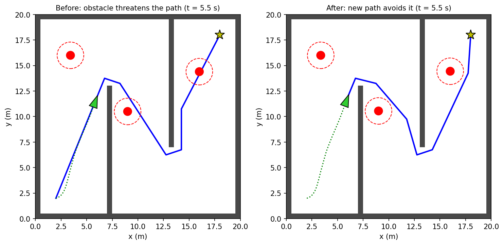
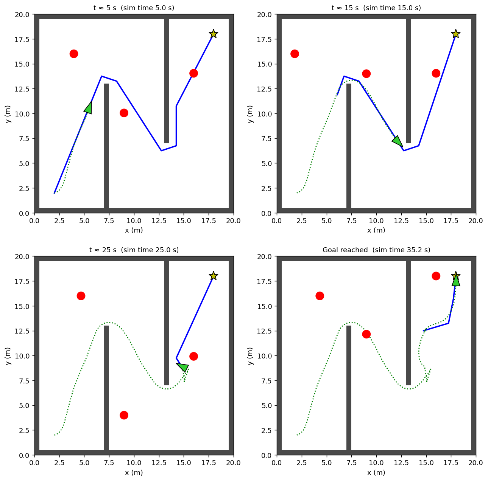

# Localization + Path Planning for a Self-Driving Car (Python)

A small 2D simulation where a car localizes itself with noisy sensors, plans a route with **A\***, and avoids **moving obstacles** on the way to a goal. Pure Python, no ROS needed to run it.


## Quick test (2 minutes)

```bash
pip install numpy scipy matplotlib
python3 main.py
```

A window opens and the car drives from the start (bottom-left) to the goal star (top-right). The console prints a status line every simulated second.

**What to look for:**

- Blue line = planned path, green triangle = car, red circles = moving obstacles
- Console prints `obstacle on path -> replanned` when the car reroutes
- The run ends with `GOAL REACHED in ~35s, collisions: 0`



## Try changing things (`config.py`)

| Change | What you should see |
|---|---|
| `SEED = 2` (or any number) | Different sensor noise, still reaches the goal |
| `GPS_GAIN = 0` and `HEADING_GAIN = 0` | Sensor fusion off: `loc_err` in the console climbs to several meters, and the car believes it has arrived while sitting far from the real goal (run ends in `TIMEOUT`) |
| `START` / `GOAL` | Any free spot on the 20 m x 20 m map |

## What's implemented

| Requirement | File |
|---|---|
| Grid map + dynamic obstacles | `grid_map.py` |
| Localization (odometry + GPS/compass fusion, 20 Hz) | `localization.py` |
| A\* + path smoothing (from scratch) | `a_star_planner.py` |
| Safety monitor, replanning, pure pursuit | `controller.py` |
| Live visualization | `visualizer.py` |
| Main loop | `main.py` |
| Optional ROS 2 node (`/map`, `/estimated_pose`, `/cmd_vel`) | `ros2_wrapper.py` |

## Results

Tested on 5 noise seeds: the goal was reached every time with **0 collisions** (25 to 36 s). Fused localization error stayed around **0.1 m**, versus more than **5 m** drift with dead reckoning alone.



The ROS 2 wrapper is optional and was not needed for these results.